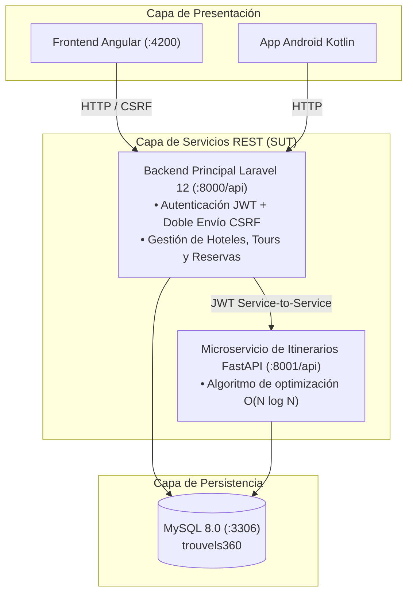

# Proyecto-Calidad — Ecosistema Trouvels360
### Asignatura: Calidad de Software (C8305) — Universidad Peruana Cayetano Heredia (UPCH)
**Coordinador del Curso:** Mg. Ing. Gustavo Henry Pachas Quispe  
**Estudiante:** Matías Huerta  
**Semestre Académico:** 2026-II  

---

## 1. Descripción del Proyecto

Este repositorio contiene la solución de software y sus artefactos de calidad para **Trouvels360**, un marketplace turístico que conecta a proveedores de alojamiento y tours con viajeros e integra un microservicio de optimización de itinerarios. La versión vigente está directamente en la raíz; toda la documentación está en [docs/README.md](docs/README.md); las versiones de cada etapa están en el historial de Git.

El repositorio implementa un enfoque de pruebas en múltiples niveles:
- **Especificación ágil:** 30 historias de usuario (15 del viajero y 15 del proveedor) con 130 criterios de aceptación Dado / Cuando / Entonces, todos cubiertos por al menos uno de los 160 casos de prueba.
- **Pruebas de API:** suite de regresión centralizada en `qa/karate/` con Karate 1.4.1.
- **Pruebas E2E:** Selenium 4 para la web y Appium 2 para Android, con trazabilidad por caso.
- **Pruebas de rendimiento:** suite JMeter 5.6.3 y smoke test de concurrencia en `qa/jmeter/`.
- **Colección complementaria:** Postman & Newman en `qa/postman/`, con aserciones `pm.test(...)` y reportería HTML (`htmlextra`).

`qa/` es la ubicación única de las suites, los ejecutores y la trazabilidad de pruebas. Los servicios de aplicación permanecen en sus carpetas raíz; las implementaciones anteriores se conservan en el historial de Git.

---

## 2. Arquitectura del SUT (Sistema Bajo Prueba)



---

## 3. Estructura del Repositorio

```text
Proyecto-Calidad/
├── backend-laravel/           # API REST y compose del backend
├── backend-itinerarios/       # Microservicio FastAPI
├── frontend-angular/          # Aplicación web Angular
├── android/                   # Aplicación Kotlin + Jetpack Compose
├── docs/
│   ├── 1-historias-de-usuario/# 15 historias del viajero, 15 del proveedor y tareas de QA
│   ├── 2-pruebas/             # Estrategia y catálogo de los 160 casos
│   ├── 3-trazabilidad/        # Matriz historia → criterio → caso → resultado y defectos
│   └── 4-jira/                # CSV de importación y guía de Jira
├── qa/
│   ├── karate/                # Regresión API (Etapa 5)
│   ├── selenium/              # Pruebas E2E web
│   ├── appium/                # Pruebas E2E Android
│   ├── jmeter/                # Carga, concurrencia y smoke test
│   ├── postman/               # Colección complementaria de API
│   ├── trazabilidad/          # Matriz HU/criterio/caso/resultado y CSV Jira
│   └── evidencias/etapa-5/    # Reportes y capturas entregadas
└── README.md
```

---

## 4. Historias de usuario

Detalle completo en [docs/1-historias-de-usuario/](docs/1-historias-de-usuario/README.md) y trazabilidad en [docs/3-trazabilidad/](docs/3-trazabilidad/matriz-de-trazabilidad.md).

| Viajero | Proveedor |
| :--- | :--- |
| `HU-V01` Crear mi cuenta de viajero | `HU-P01` Crear mi cuenta de proveedor |
| `HU-V02` Iniciar sesión y volver a lo que estaba haciendo | `HU-P02` Entrar a mi panel y mantener los datos de mi empresa |
| `HU-V03` Actualizar mis datos y mi contraseña | `HU-P03` Ver mis publicaciones |
| `HU-V04` Eliminar mi cuenta | `HU-P04` Ver los indicadores de mi negocio |
| `HU-V05` Buscar hoteles disponibles | `HU-P05` Publicar un hotel |
| `HU-V06` Ver un hotel y cotizar mi estadía | `HU-P06` Editar un hotel |
| `HU-V07` Reservar un hotel con pago simulado | `HU-P07` Gestionar los tipos de habitación |
| `HU-V08` Buscar tours | `HU-P08` Publicar un tour |
| `HU-V09` Ver un tour y cotizar | `HU-P09` Editar un tour |
| `HU-V10` Reservar un tour | `HU-P10` Armar el programa de actividades del tour |
| `HU-V11` Ver mis reservas | `HU-P11` Programar salidas y cupos |
| `HU-V12` Saber si el hotel aceptó o rechazó mi solicitud | `HU-P12` Ver las reservas que recibo |
| `HU-V13` Cancelar una reserva | `HU-P13` Aceptar una solicitud de hotel |
| `HU-V14` Leer y escribir reseñas | `HU-P14` Rechazar una solicitud de hotel |
| `HU-V15` Recibir un itinerario sugerido | `HU-P15` Eliminar una publicación |

---

## 5. Instrucciones de Ejecución

### Configuración local

Los archivos `.env` contienen configuración local y no se versionan. Antes de ejecutar, restaura tus copias locales si faltan:

- `backend-laravel/.env`
- `backend-itinerarios/.env.fastapi`
- `frontend-angular/.env` (solo si tu configuración local lo requiere)

Laravel puede copiar `.env.example` automáticamente si no encuentra `.env`. Para Python, copia `.env.fastapi.example` a `.env.fastapi` y verifica que `JWT_SECRET` coincida con `JWT_MS_SECRET` de Laravel. No reemplaces tus archivos locales ni los agregues al commit.

### Iniciar en Windows

Abre una terminal PowerShell por servicio. Ejecuta cada `.bat` desde la carpeta de su componente; los scripts resuelven sus rutas desde su propia ubicación.

1. Backend Laravel (Docker Desktop debe estar iniciado):

```powershell
Set-Location .\backend-laravel
.\levantar.bat
```

`levantar.bat` ejecuta `migrate:fresh --seed`, por lo que recrea la base de datos con datos de prueba.

2. Microservicio de itinerarios, después de que Laravel haya creado la red Docker:

```powershell
Set-Location .\backend-itinerarios
.\levantar.bat
```

3. Aplicación web:

```powershell
Set-Location .\frontend-angular
.\iniciar-docker.bat
```

La web queda en http://localhost:4200, Laravel en http://localhost:8000/api/ping y FastAPI en http://localhost:8001/api/health.

4. Android: abre la carpeta `android/` en Android Studio, sincroniza Gradle y ejecuta la app en un emulador API 26 o superior.

Para detener servicios, ejecuta `detener.bat` en `backend-laravel/`, `detener-docker.bat` en `frontend-angular/` y `docker compose down` desde `backend-itinerarios/`.

### Colección Postman complementaria

La colección conservada en `qa/postman/` no forma parte del runner principal de Etapa 5. Sus endpoints o datos podrían requerir actualización para coincidir con el contrato vigente.

```powershell
Set-Location .\qa\postman
npm install
npm test
```

El reporte se genera en `qa/postman/reports/newman-report.html`.

### JMeter

Ejecuta la suite vigente desde la raíz con `qa/jmeter/ejecutar.bat` o abre `qa/jmeter/trouvels360.jmx` en JMeter. En Windows, los scripts `.sh` requieren Git Bash o WSL. Los resultados se generan bajo `qa/jmeter/resultados/`.

### Regresión automatizada de Etapa 5

Con los servicios locales iniciados y las dependencias de cada suite instaladas:

```powershell
.\qa\ejecutar-todo.bat
```

El comando ejecuta Karate y Selenium y actualiza la matriz de trazabilidad. Para incluir JMeter y Appium (requieren JMeter y un emulador/Appium en ejecución):

```powershell
.\qa\ejecutar-todo.bat jmeter appium
```

También puedes ejecutar cada suite desde su carpeta con `ejecutar.bat`. La estrategia, los entornos y el estado de cada suite están en [docs/2-pruebas/estrategia-de-pruebas.md](docs/2-pruebas/estrategia-de-pruebas.md). Los reportes originales se conservan en `qa/evidencias/etapa-5/`; las nuevas ejecuciones escriben sus resultados bajo `target/` o `resultados/`.

---

## 6. Defectos

Los defectos encontrados en la auditoría inicial, en la revisión de las APIs y al ejecutar las suites (21 en total, 19 corregidos y 2 triviales abiertos en los reportes de QA) están en [docs/3-trazabilidad/defectos.md](docs/3-trazabilidad/defectos.md), cada uno con el criterio que incumplía y el caso que lo detecta.
