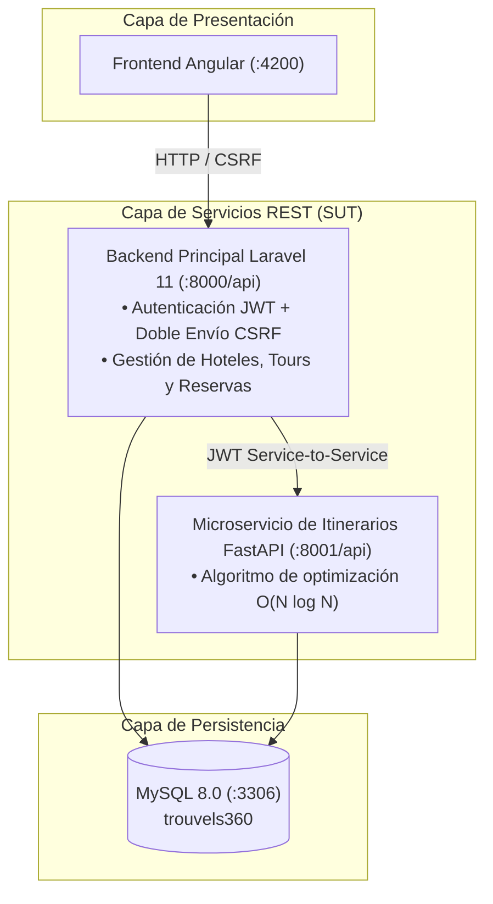

# Proyecto-Calidad — Ecosistema Trouvels360
### Asignatura: Calidad de Software (C8305) — Universidad Peruana Cayetano Heredia (UPCH)
**Coordinador del Curso:** Mg. Ing. Gustavo Henry Pachas Quispe  
**Estudiante:** Matías Huerta  
**Semestre Académico:** 2026-II  

---

## 1. Descripción del Proyecto

Este repositorio contiene la solución integral de aseguramiento de calidad y pruebas de software para la plataforma **Trouvels360**, un marketplace turístico que conecta a proveedores de alojamiento y tours con viajeros, integrando un motor inteligente de optimización de itinerarios en microservicios.

El repositorio implementa un enfoque de pruebas en múltiples niveles:
- **Especificación Ágil:** 20 Historias de Usuario completas (10 para Proveedor y 10 para Viajero) con criterios de aceptación en formato Given-When-Then.
- **Automatización BDD con Karate Framework 1.5.2:** Cobertura de métodos `GET`, `POST`, `PUT`, `DELETE` con escenarios parametrizados (`Scenario Outline` y `Examples`).
- **Pruebas de Servicios con Postman & Newman:** Colección completa v2.1 con aserciones `pm.test(...)` y reportería HTML interactiva (`htmlextra`).
- **Pruebas Funcionales y de Rendimiento con Apache JMeter 5.6.3:** Catálogo de comandos `curl` listos para importar vía `Tools → Import from cURL`, plan funcional de Samplers HTTP encadenados y plan de pruebas de Carga/Stress.

---

## 2. Arquitectura del SUT (Sistema Bajo Prueba)



---

## 3. Estructura del Repositorio

```text
Proyecto-Calidad/
├── backend-laravel/          # Código fuente del backend principal PHP Laravel 11
├── backend-itinerarios/      # Código fuente del microservicio Python FastAPI
├── frontend-angular/         # Código fuente de la aplicación cliente Angular
├── docker-compose.yml        # Orquestación de contenedores del entorno local
├── scripts/
│   └── start_sut.sh          # Script de verificación y configuración del SUT
├── docs/
│   ├── historias-usuario/
│   │   ├── HU_Proveedor.md   # 10 Historias de Usuario del Proveedor (HU-PRO-001..010)
│   │   └── HU_Viajero.md     # 10 Historias de Usuario del Viajero (HU-VIA-001..010)
│   └── trazabilidad/
│       └── Matriz_Trazabilidad_y_Defectos.md # Matriz bidireccional y reporte DEF-001..003
├── karate-tests/             # Suite BDD con Karate Framework 1.5.2 + JUnit 5
│   ├── pom.xml
│   └── src/test/java/trouvels360/
│       ├── common/           # Helpers reutilizables (CSRF y Auth JWT)
│       ├── proveedor/        # Features BDD del rol Proveedor (CRUD)
│       ├── viajero/          # Features BDD del rol Viajero (CRUD)
│       └── Trouvels360Runner.java
├── postman/                  # Pruebas de Servicios con Postman & Newman
│   ├── Trouvels360_API.postman_collection.json # Colección v2.1 con 40 requests GET/POST/PUT/DELETE
│   ├── Trouvels360_Local.postman_environment.json
│   ├── package.json
│   └── reports/              # Reportes HTML generados con Newman
└── jmeter/                   # Apache JMeter & Catálogo cURL
    ├── curl/
    │   ├── Catalogo_cURL_JMeter.md # Catálogo de importación cURL a Samplers JMeter
    │   └── run_curls_crud.sh       # Script ejecutable bash de peticiones cURL
    ├── plans/
    │   ├── Trouvels360_CRUD_cURL.jmx      # Plan Funcional CRUD importado de cURL
    │   └── Trouvels360_Carga_y_Stress.jmx # Plan de Rendimiento y Carga concurrente
    └── run_jmeter.sh         # Script runner de JMeter en modo no-GUI con dashboards HTML
```

---

## 4. Resumen de las 20 Historias de Usuario

| Módulo | ID HU | Título de la Historia de Usuario | Verbos HTTP Probados |
| :--- | :--- | :--- | :--- |
| **Proveedor** | `HU-PRO-001` | Registrarme y gestionar mi sesión como proveedor | `POST` |
| **Proveedor** | `HU-PRO-002` | Gestionar mi perfil y cuenta de proveedor | `GET`, `PUT`, `DELETE` |
| **Proveedor** | `HU-PRO-003` | Consultar mis publicaciones e indicadores | `GET` |
| **Proveedor** | `HU-PRO-004` | Publicar y editar hoteles | `POST`, `GET`, `PUT` |
| **Proveedor** | `HU-PRO-005` | Gestionar habitaciones de un hotel | `POST`, `PUT`, `DELETE` |
| **Proveedor** | `HU-PRO-006` | Publicar y editar tours | `POST`, `GET`, `PUT` |
| **Proveedor** | `HU-PRO-007` | Gestionar actividades del itinerario del tour | `POST`, `GET`, `PUT`, `DELETE` |
| **Proveedor** | `HU-PRO-008` | Gestionar salidas y cupos del tour | `POST`, `GET`, `PUT`, `DELETE` |
| **Proveedor** | `HU-PRO-009` | Consultar reservas recibidas de mis servicios | `GET` |
| **Proveedor** | `HU-PRO-010` | Retirar y eliminar publicaciones propias | `DELETE`, `GET` |
| **Viajero** | `HU-VIA-001` | Registrarme y gestionar mi sesión como viajero | `POST` |
| **Viajero** | `HU-VIA-002` | Gestionar mi perfil y cuenta de viajero | `GET`, `PUT`, `DELETE` |
| **Viajero** | `HU-VIA-003` | Buscar hoteles y consultar disponibilidad | `GET` |
| **Viajero** | `HU-VIA-004` | Solicitar reserva de hotel | `POST` |
| **Viajero** | `HU-VIA-005` | Consultar mis reservas y estados actuales | `GET` |
| **Viajero** | `HU-VIA-006` | Buscar tours y consultar salidas programadas | `GET` |
| **Viajero** | `HU-VIA-007` | Reservar un tour y asegurar cupos | `POST` |
| **Viajero** | `HU-VIA-008` | Cancelar reservas propias | `POST` |
| **Viajero** | `HU-VIA-009` | Generar sugerencias de itinerario optimizado | `GET`, `POST` |
| **Viajero** | `HU-VIA-010` | Consultar, publicar y gestionar reseñas | `GET`, `POST`, `PUT`, `DELETE` |

*Para el detalle completo de criterios y esquemas JSON consultar [docs/historias-usuario/](docs/historias-usuario/) y [docs/trazabilidad/](docs/trazabilidad/).*

---

## 5. Instrucciones de Ejecución

### Prerrequisito: Iniciar el Entorno SUT
```bash
# Configurar variables de entorno y levantar contenedores
./scripts/start_sut.sh
docker compose up -d --build

# Verificar que los servicios responden
curl -s http://localhost:8000/api/ping
curl -s http://localhost:8001/api/health
```

### 1. Pruebas BDD con Karate Framework
```bash
cd karate-tests
mvn clean test
```
*Reporte generado:* `karate-tests/target/karate-reports/karate-summary.html`

### 2. Pruebas de Servicios con Postman & Newman
```bash
cd postman
npm install
npm test
```
*Reporte generado:* `postman/reports/newman-report.html`

### 3. Ejecución de cURL y Apache JMeter
```bash
# 3.1 Ejecutar comandos cURL en terminal
./jmeter/curl/run_curls_crud.sh

# 3.2 Ejecutar Planes JMeter (CRUD Funcional + Carga) y generar Dashboards HTML
./jmeter/run_jmeter.sh
```
*Dashboards generados:*
- `jmeter/reports/crud-dashboard/index.html` (Pruebas Funcionales CRUD)
- `jmeter/reports/load-dashboard/index.html` (Pruebas de Carga y Rendimiento)

---

## 6. Reporte de Defectos Identificados en el SUT (Caja Negra)

Durante la auditoría de calidad y automatización se mantuvieron los tres componentes de backend intactos y se registraron formalmente los siguientes hallazgos:
1. **DEF-001 (Mayor):** Inconsistencia de nombre de columna en `ReservaTourController.php` (`precio_persona` vs `precio`), provocando cálculo de total en `$0.0`.
2. **DEF-002 (Medio):** Ausencia de endpoint mutador de aceptación/rechazo manual de reservas de hotel para el rol proveedor en `routes/api.php`.
3. **DEF-003 (Menor):** `DELETE /api/hoteles/{id}` elimina la entidad hija `hoteles` sin eliminar el registro padre en `servicios` (a diferencia de `DELETE /api/servicios/{id}` que realiza soft-delete en cascada).
