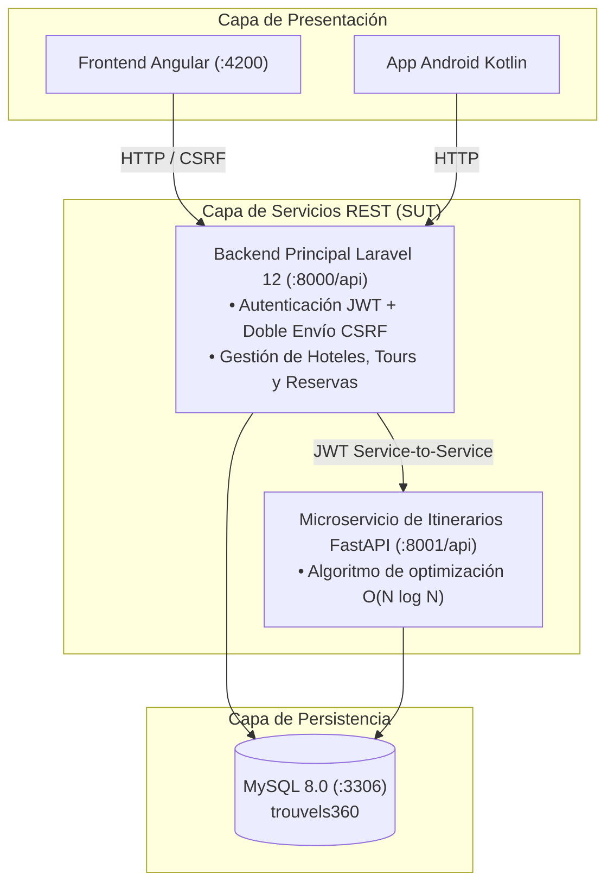

# Proyecto-Calidad — Ecosistema Trouvels360
### Asignatura: Calidad de Software (C8305) — Universidad Peruana Cayetano Heredia (UPCH)
**Coordinador del Curso:** Mg. Ing. Gustavo Henry Pachas Quispe  
**Integrantes:**
- Edwin Junior Jara Bocanegra
- Josué Abel Florián Párraga
- Matias Dario Huerta Cruz
- Camilo Sebastián Silva Cuzqui

**Semestre Académico:** 2026-II  

---

## 1. Descripción del Proyecto

Este repositorio contiene la solución de software y sus artefactos de calidad para **Trouvels360**, un marketplace turístico que conecta a proveedores de alojamiento y tours con viajeros e integra un microservicio de optimización de itinerarios. La versión vigente está directamente en la raíz; toda la documentación está en [docs/README.md](docs/README.md); las versiones de cada etapa están en el historial de Git.

El repositorio implementa un enfoque de pruebas en múltiples niveles:
- **Especificación ágil:** 30 historias de usuario (15 del viajero y 15 del proveedor) con 130 criterios de aceptación Dado / Cuando / Entonces, todos cubiertos por al menos uno de los 160 casos de prueba.
- **Pruebas de API:** suite de regresión centralizada en `qa/karate/` con Karate 1.4.1.
- **Pruebas E2E:** Selenium 4 para la web y Appium 2 para Android, con trazabilidad por caso.
- **Pruebas de rendimiento:** suite JMeter 5.6.3 y smoke test de concurrencia en `qa/jmeter/`.
- **Colección complementaria:** Postman & Newman en `qa/postman/`, con aserciones `pm.test(...)` y reportería HTML (`htmlextra`).

`qa/` es la ubicación única de las suites, los ejecutores y la trazabilidad de pruebas. Los servicios de aplicación permanecen en sus carpetas raíz; las implementaciones anteriores se conservan en el historial de Git.

---

## 2. Arquitectura del SUT (Sistema Bajo Prueba)



---

## 3. Estructura del Repositorio

```text
Proyecto-Calidad/
├── backend/                         # Las dos APIs; cada una con su propio Docker
│   ├── docker-compose.yml           #   levanta las dos a la vez
│   ├── levantar-todo.bat · detener-todo.bat
│   ├── api-laravel/                 # API REST principal: Laravel 12 + MySQL 8 (:8000)
│   │   ├── app/ · routes/ · database/   #   código, rutas (con su historia) y seeders (incluye QaSeeder)
│   │   ├── tests/Feature/           #   61 pruebas Pest
│   │   ├── docs/                    #   referencia de la API, datos de prueba, cambios de la etapa 2
│   │   ├── docker/ · Dockerfile · docker-compose.yml · .env.example
│   │   └── levantar.bat · detener.bat · reiniciar-datos.bat · probar.bat
│   └── api-python/                  # API de itinerarios: FastAPI (:8001)
│       ├── app/ · tests/            #   código y 13 pruebas pytest
│       └── Dockerfile · docker-compose.yml · .env.fastapi.example · railway.json · *.bat
├── frontend/                        # Web Angular 19, servida con nginx en Docker (:4200)
│   ├── src/app/                     #   core/ · shared/ · features/ (auth, hoteles, tours, proveedor)
│   ├── docs/                        #   selectores para Selenium, cambios de la etapa 3
│   ├── docker/ · Dockerfile · docker-compose.yml · .env.example · proxy.conf.json
│   └── levantar.bat · detener.bat · desarrollo.bat
├── android/                         # App Kotlin + Jetpack Compose (viajero y proveedor)
│   ├── app/src/main/                #   pantallas, red (Retrofit + cookies + CSRF), validaciones
│   ├── app/src/test/                #   pruebas unitarias y de contrato con la API
│   ├── docs/                        #   contrato de la API, selectores y guía para Appium
│   └── build.gradle.kts · gradle.properties (API_BASE_URL) · gradlew
├── qa/                              # Pruebas de la rúbrica
│   ├── karate/                      #   API: 86 casos (136 escenarios)
│   ├── selenium/                    #   web: 33 casos
│   ├── appium/                      #   app: 32 casos
│   ├── jmeter/                      #   rendimiento y concurrencia: 6 casos + prueba rápida en Python
│   ├── trazabilidad/                #   matriz historia → criterio → caso → resultado
│   ├── evidencias/                  #   reportes de la última corrida (karate/, selenium/, jmeter/)
│   ├── postman/                     #   colección complementaria (versión base)
│   └── ejecutar-todo.bat · ejecutar-todo.sh
├── docs/                            # Documentación del curso
│   ├── 1-historias-de-usuario/      #   15 historias del viajero, 15 del proveedor, tareas de QA, Word
│   ├── 2-pruebas/                   #   estrategia y catálogo de los 160 casos
│   ├── 3-trazabilidad/              #   matriz (md + csv) y registro de defectos
│   └── 4-jira/                      #   CSV de importación y guía de Jira
├── .gitignore
└── README.md
```

Cada carpeta principal tiene su propio `README.md` con cómo levantarla, configurarla y probarla.

---

## 4. Historias de usuario

Detalle completo en [docs/1-historias-de-usuario/](docs/1-historias-de-usuario/README.md) y trazabilidad en [docs/3-trazabilidad/](docs/3-trazabilidad/matriz-de-trazabilidad.md).

| Viajero | Proveedor |
| :--- | :--- |
| `HU-V01` Crear mi cuenta de viajero | `HU-P01` Crear mi cuenta de proveedor |
| `HU-V02` Iniciar sesión y volver a lo que estaba haciendo | `HU-P02` Entrar a mi panel y mantener los datos de mi empresa |
| `HU-V03` Actualizar mis datos y mi contraseña | `HU-P03` Ver mis publicaciones |
| `HU-V04` Eliminar mi cuenta | `HU-P04` Ver los indicadores de mi negocio |
| `HU-V05` Buscar hoteles disponibles | `HU-P05` Publicar un hotel |
| `HU-V06` Ver un hotel y cotizar mi estadía | `HU-P06` Editar un hotel |
| `HU-V07` Reservar un hotel con pago simulado | `HU-P07` Gestionar los tipos de habitación |
| `HU-V08` Buscar tours | `HU-P08` Publicar un tour |
| `HU-V09` Ver un tour y cotizar | `HU-P09` Editar un tour |
| `HU-V10` Reservar un tour | `HU-P10` Armar el programa de actividades del tour |
| `HU-V11` Ver mis reservas | `HU-P11` Programar salidas y cupos |
| `HU-V12` Saber si el hotel aceptó o rechazó mi solicitud | `HU-P12` Ver las reservas que recibo |
| `HU-V13` Cancelar una reserva | `HU-P13` Aceptar una solicitud de hotel |
| `HU-V14` Leer y escribir reseñas | `HU-P14` Rechazar una solicitud de hotel |
| `HU-V15` Recibir un itinerario sugerido | `HU-P15` Eliminar una publicación |

---

## 5. Instrucciones de Ejecución

### Backend (las dos APIs)

Cada API tiene su propio Docker y su propia dirección, y se pueden levantar a la vez. Guía completa (cómo se conectan,
variables, despliegue en la nube cada una en su dominio y problemas frecuentes) en [backend/README.md](backend/README.md).

Con Docker Desktop abierto, en Windows:

```powershell
.\backend\levantar-todo.bat            # las dos a la vez (o desde backend\: docker compose up -d --build)
```

O cada una por separado, primero Laravel:

```powershell
.\backend\api-laravel\levantar.bat     # API Laravel + MySQL → http://localhost:8000/api/ping
.\backend\api-python\levantar.bat      # API de itinerarios  → http://localhost:8001/api/health
```

Cada `levantar.bat` crea su archivo de configuración desde el ejemplo si falta (`backend/api-laravel/.env` y
`backend/api-python/.env.fastapi`); los ejemplos ya traen los valores compartidos entre ambas para desarrollo local.
Esos archivos no se versionan. Para detener: `backend\detener-todo.bat`, o `detener.bat` en cada carpeta.

### Aplicación web

Con la API levantada, doble clic en `frontend\levantar.bat` (o `docker compose up -d --build` desde `frontend/`). La web
queda en http://localhost:4200 y reenvía `/api` a la API. Para detenerla: `frontend\detener.bat`. Modo desarrollo sin
Docker y despliegue en la nube: [frontend/README.md](frontend/README.md).

### Android

Abre la carpeta `android/` en Android Studio, elige **JDK 21** como *Gradle JDK* (el JBR 21 que trae Android Studio;
con Java 25 Gradle no sincroniza), sincroniza y ejecuta la app en un emulador API 26 o superior. La app llega a la API de
tu PC por `http://10.0.2.2:8000/api/`. Detalles y cómo apuntarla a la nube: [android/README.md](android/README.md).

### Colección Postman complementaria

La colección conservada en `qa/postman/` no forma parte del runner principal de Etapa 5. Sus endpoints o datos podrían requerir actualización para coincidir con el contrato vigente.

```powershell
Set-Location .\qa\postman
npm install
npm test
```

El reporte se genera en `qa/postman/reports/newman-report.html`.

### JMeter

Ejecuta la suite vigente desde la raíz con `qa/jmeter/ejecutar.bat` o abre `qa/jmeter/trouvels360.jmx` en JMeter. En Windows, los scripts `.sh` requieren Git Bash o WSL. Los resultados se generan bajo `qa/jmeter/resultados/`.

### Pruebas automatizadas (`qa/`)

Requisitos, preparación del entorno (límites de la API y datos limpios) y estado de cada suite en
[qa/README.md](qa/README.md). Las suites en Java necesitan **JDK 21** y Maven. Con todo levantado:

```powershell
.\qa\ejecutar-todo.bat
```

El comando ejecuta Karate y Selenium y actualiza la matriz de trazabilidad. Para incluir JMeter y Appium (requieren JMeter y un emulador/Appium en ejecución):

```powershell
.\qa\ejecutar-todo.bat jmeter appium
```

También puedes ejecutar cada suite desde su carpeta con `ejecutar.bat`. La estrategia, los entornos y el estado de cada suite están en [docs/2-pruebas/estrategia-de-pruebas.md](docs/2-pruebas/estrategia-de-pruebas.md). Los reportes de la última corrida se conservan en `qa/evidencias/`; las nuevas ejecuciones escriben sus resultados bajo `target/` o `resultados/`.

---

## 6. Defectos

Los defectos encontrados en la auditoría inicial, en la revisión de las APIs y al ejecutar las suites (23 en total, todos corregidos) están en [docs/3-trazabilidad/defectos.md](docs/3-trazabilidad/defectos.md), cada uno con el criterio que incumplía y el caso que lo detecta.
