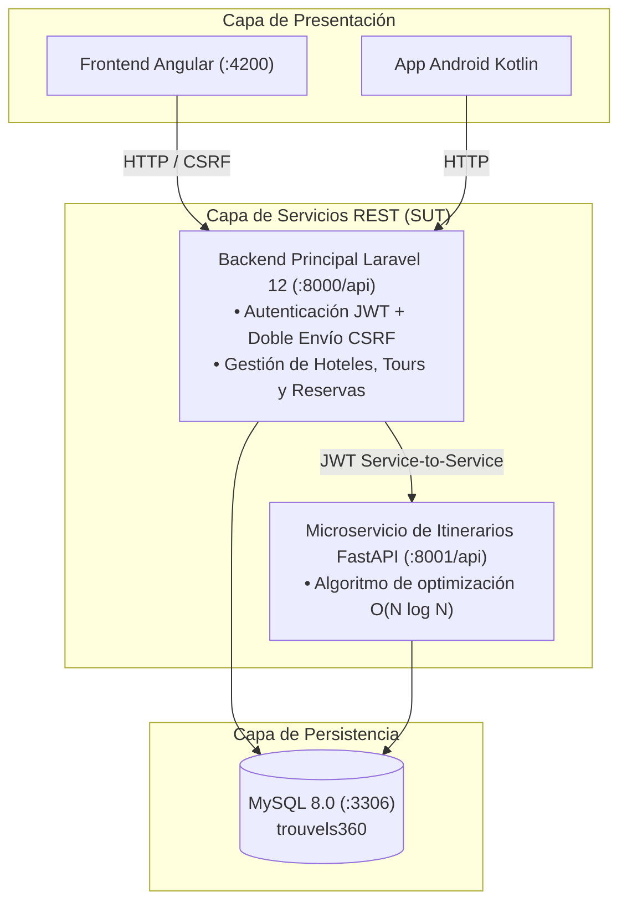

# Proyecto-Calidad — Ecosistema Trouvels360
### Asignatura: Calidad de Software (C8305) — Universidad Peruana Cayetano Heredia (UPCH)
**Coordinador del Curso:** Mg. Ing. Gustavo Henry Pachas Quispe  
**Estudiante:** Matías Huerta  
**Semestre Académico:** 2026-II  

---

## 1. Descripción del Proyecto

Este repositorio contiene la solución de software y sus artefactos de calidad para **Trouvels360**, un marketplace turístico que conecta a proveedores de alojamiento y tours con viajeros e integra un microservicio de optimización de itinerarios. La versión vigente está directamente en la raíz; la evolución de cada etapa se documenta en [docs/etapas/README.md](docs/etapas/README.md).

El repositorio implementa un enfoque de pruebas en múltiples niveles:
- **Especificación Ágil:** 20 Historias de Usuario completas (10 para Proveedor y 10 para Viajero) con criterios de aceptación en formato Given-When-Then.
- **Automatización BDD con Karate Framework 1.5.2:** Cobertura de métodos `GET`, `POST`, `PUT`, `DELETE` con escenarios parametrizados (`Scenario Outline` y `Examples`).
- **Pruebas de Servicios con Postman & Newman:** Colección completa v2.1 con aserciones `pm.test(...)` y reportería HTML interactiva (`htmlextra`).
- **Pruebas Funcionales y de Rendimiento con Apache JMeter 5.6.3:** Catálogo de comandos `curl` listos para importar vía `Tools → Import from cURL`, plan funcional de Samplers HTTP encadenados y plan de pruebas de Carga/Stress.

Las implementaciones anteriores se conservan en el historial de Git. Las herramientas de Karate, Postman y JMeter se mantienen en la raíz como recursos de aseguramiento de calidad.

---

## 2. Arquitectura del SUT (Sistema Bajo Prueba)



---

## 3. Estructura del Repositorio

```text
Proyecto-Calidad/
├── backend-laravel/           # API REST y compose del backend
├── backend-itinerarios/       # Microservicio FastAPI
├── frontend-angular/          # Aplicación web Angular
├── android/                   # Aplicación Kotlin + Jetpack Compose
├── docs/
│   ├── etapas/                # Hitos, cambios y entregables por etapa
│   ├── historias-usuario/     # Historias y criterios de aceptación
│   └── trazabilidad/          # Matriz de trazabilidad y defectos
├── karate-tests/              # Pruebas BDD
├── postman/                   # Pruebas de API con Newman
├── jmeter/                    # Pruebas funcionales y de rendimiento
└── README.md
```

---

## 4. Resumen de las 20 Historias de Usuario

| Módulo | ID HU | Título de la Historia de Usuario | Verbos HTTP Probados |
| :--- | :--- | :--- | :--- |
| **Proveedor** | `HU-PRO-001` | Registrarme y gestionar mi sesión como proveedor | `POST` |
| **Proveedor** | `HU-PRO-002` | Gestionar mi perfil y cuenta de proveedor | `GET`, `PUT`, `DELETE` |
| **Proveedor** | `HU-PRO-003` | Consultar mis publicaciones e indicadores | `GET` |
| **Proveedor** | `HU-PRO-004` | Publicar y editar hoteles | `POST`, `GET`, `PUT` |
| **Proveedor** | `HU-PRO-005` | Gestionar habitaciones de un hotel | `POST`, `PUT`, `DELETE` |
| **Proveedor** | `HU-PRO-006` | Publicar y editar tours | `POST`, `GET`, `PUT` |
| **Proveedor** | `HU-PRO-007` | Gestionar actividades del itinerario del tour | `POST`, `GET`, `PUT`, `DELETE` |
| **Proveedor** | `HU-PRO-008` | Gestionar salidas y cupos del tour | `POST`, `GET`, `PUT`, `DELETE` |
| **Proveedor** | `HU-PRO-009` | Consultar reservas recibidas de mis servicios | `GET` |
| **Proveedor** | `HU-PRO-010` | Retirar y eliminar publicaciones propias | `DELETE`, `GET` |
| **Viajero** | `HU-VIA-001` | Registrarme y gestionar mi sesión como viajero | `POST` |
| **Viajero** | `HU-VIA-002` | Gestionar mi perfil y cuenta de viajero | `GET`, `PUT`, `DELETE` |
| **Viajero** | `HU-VIA-003` | Buscar hoteles y consultar disponibilidad | `GET` |
| **Viajero** | `HU-VIA-004` | Solicitar reserva de hotel | `POST` |
| **Viajero** | `HU-VIA-005` | Consultar mis reservas y estados actuales | `GET` |
| **Viajero** | `HU-VIA-006` | Buscar tours y consultar salidas programadas | `GET` |
| **Viajero** | `HU-VIA-007` | Reservar un tour y asegurar cupos | `POST` |
| **Viajero** | `HU-VIA-008` | Cancelar reservas propias | `POST` |
| **Viajero** | `HU-VIA-009` | Generar sugerencias de itinerario optimizado | `GET`, `POST` |
| **Viajero** | `HU-VIA-010` | Consultar, publicar y gestionar reseñas | `GET`, `POST`, `PUT`, `DELETE` |

*Para el detalle completo de criterios y esquemas JSON consultar [docs/historias-usuario/](docs/historias-usuario/) y [docs/trazabilidad/](docs/trazabilidad/).*

---

## 5. Instrucciones de Ejecución

### Configuración local

Los archivos `.env` contienen configuración local y no se versionan. Antes de ejecutar, restaura tus copias locales si faltan:

- `backend-laravel/.env`
- `backend-itinerarios/.env.fastapi`
- `frontend-angular/.env` (solo si tu configuración local lo requiere)

Laravel puede copiar `.env.example` automáticamente si no encuentra `.env`. Para Python, copia `.env.fastapi.example` a `.env.fastapi` y verifica que `JWT_SECRET` coincida con `JWT_MS_SECRET` de Laravel. No reemplaces tus archivos locales ni los agregues al commit.

### Iniciar en Windows

Abre una terminal PowerShell por servicio. Ejecuta cada `.bat` desde la carpeta de su componente; los scripts resuelven sus rutas desde su propia ubicación.

1. Backend Laravel (Docker Desktop debe estar iniciado):

```powershell
Set-Location .\backend-laravel
.\levantar.bat
```

`levantar.bat` ejecuta `migrate:fresh --seed`, por lo que recrea la base de datos con datos de prueba.

2. Microservicio de itinerarios, después de que Laravel haya creado la red Docker:

```powershell
Set-Location .\backend-itinerarios
.\levantar.bat
```

3. Aplicación web:

```powershell
Set-Location .\frontend-angular
.\iniciar-docker.bat
```

La web queda en http://localhost:4200, Laravel en http://localhost:8000/api/ping y FastAPI en http://localhost:8001/api/health.

4. Android: abre la carpeta `android/` en Android Studio, sincroniza Gradle y ejecuta la app en un emulador API 26 o superior.

Para detener servicios, ejecuta `detener.bat` en `backend-laravel/`, `detener-docker.bat` en `frontend-angular/` y `docker compose down` desde `backend-itinerarios/`.

### 1. Pruebas BDD con Karate Framework
```bash
cd karate-tests
mvn clean test
```
*Reporte generado:* `karate-tests/target/karate-reports/karate-summary.html`

### 2. Pruebas de Servicios con Postman & Newman
```bash
cd postman
npm install
npm test
```
*Reporte generado:* `postman/reports/newman-report.html`

### 3. Ejecución de cURL y Apache JMeter
En Windows, los scripts `.sh` de JMeter requieren Git Bash o WSL. Los archivos `.jmx` se pueden abrir directamente en Apache JMeter.

*Dashboards generados:*
- `jmeter/reports/crud-dashboard/index.html` (Pruebas Funcionales CRUD)
- `jmeter/reports/load-dashboard/index.html` (Pruebas de Carga y Rendimiento)

Los artefactos de Karate, Postman y JMeter se conservaron desde la versión inicial y pueden requerir ajustes de datos o endpoints para coincidir con el contrato actual.

---

## 6. Registro histórico de defectos del SUT inicial

Durante la auditoría de calidad y automatización se mantuvieron los tres componentes de backend intactos y se registraron formalmente los siguientes hallazgos:
1. **DEF-001 (Mayor):** Inconsistencia de nombre de columna en `ReservaTourController.php` (`precio_persona` vs `precio`), provocando cálculo de total en `$0.0`.
2. **DEF-002 (Medio):** Ausencia de endpoint mutador de aceptación/rechazo manual de reservas de hotel para el rol proveedor en `routes/api.php`.
3. **DEF-003 (Menor):** `DELETE /api/hoteles/{id}` elimina la entidad hija `hoteles` sin eliminar el registro padre en `servicios` (a diferencia de `DELETE /api/servicios/{id}` que realiza soft-delete en cascada).
