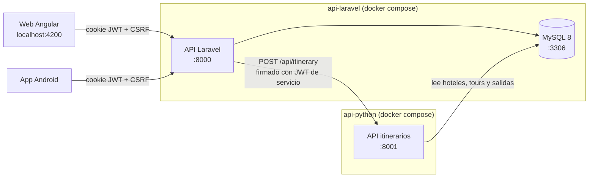

# Backend de Trouvels360

Dos APIs **independientes**: cada una tiene su propio Docker y su propia dirección, y se comunican entre sí por URL. Se
pueden levantar a la vez en el mismo equipo o desplegar cada una en su propio dominio.

| Carpeta | Qué es | Tecnología | Dirección local | Documentación |
|---|---|---|---|---|
| [`api-laravel/`](api-laravel/README.md) | API principal: cuentas, hoteles, tours, reservas, reseñas, panel del proveedor. Es la que usan la web y la app. | Laravel 12 (PHP 8.2) + MySQL 8 | http://localhost:8000/api | [README](api-laravel/README.md) |
| [`api-python/`](api-python/README.md) | API de itinerarios sugeridos (HU-V15). Solo la llama la API Laravel. | FastAPI (Python 3.11) | http://localhost:8001/api | [README](api-python/README.md) |

## Cómo se conectan



1. La web o la app piden un itinerario a la API Laravel (`POST /api/itineraries`).
2. Laravel valida los datos, **firma un JWT de servicio** (5 minutos) con la clave compartida y llama a la API Python
   en `PYTHON_MICROSERVICE_URL`.
3. La API Python verifica la firma (si no coincide responde 401), **lee** los tours de la misma base MySQL y devuelve la
   propuesta. Laravel se la reenvía al cliente.

Por eso hay **tres valores que deben coincidir** entre las dos APIs:

| En `api-laravel/.env` | En `api-python/.env.fastapi` | Para qué |
|---|---|---|
| `JWT_MS_SECRET` | `JWT_SECRET` | Clave con la que Laravel firma y Python verifica |
| `JWT_MS_ISSUER` | `JWT_ISSUER` | Quién firma (la URL pública de la API Laravel) |
| `DB_DATABASE`, `DB_USERNAME`, `DB_PASSWORD` | `DB_NAME`, `DB_USER`, `DB_PASSWORD` | La misma base de datos |

Los archivos de ejemplo (`.env.example` y `.env.fastapi.example`) **ya traen esos valores iguales** para desarrollo local.

## Levantar las dos en tu equipo

**Requisitos:** Docker Desktop abierto («Engine running») y los puertos **8000, 8001 y 3306 libres**.

> Si antes usabas las carpetas `backend-laravel` y `backend-itinerarios`, detén sus contenedores primero (en cada una:
> `docker compose down`), porque ocupan los mismos puertos.

### Windows (doble clic)

1. `api-laravel\levantar.bat` — construye la imagen, levanta MySQL y la API, crea las tablas y carga los datos de prueba.
   La primera vez tarda varios minutos (descarga imágenes e instala dependencias).
2. `api-python\levantar.bat` — construye y levanta la API de itinerarios.

Cada `levantar.bat` crea su archivo de configuración a partir del ejemplo si no existe.

### Cualquier sistema (terminal)

```bash
cd backend/api-laravel
cp .env.example .env              # solo la primera vez
docker compose up -d --build

cd ../api-python
cp .env.fastapi.example .env.fastapi   # solo la primera vez
docker compose up -d --build
```

### Comprobar que funcionan

| Qué | URL | Respuesta esperada |
|---|---|---|
| API Laravel | http://localhost:8000/api/ping | `{"pong":true}` |
| API Python | http://localhost:8001/api/health | `{"status":"healthy",…}` |
| Documentación interactiva de la API Python | http://localhost:8001/docs | Swagger UI |
| phpMyAdmin (opcional) | http://localhost:8080 | Se levanta con `docker compose --profile herramientas up -d` en `api-laravel` |

Para probar que **las dos se hablan**, inicia sesión en la web y genera un itinerario desde el detalle de un hotel, o
corre la suite de Karate (`qa/karate`, casos TC-API-054 y TC-API-055).

Usuarios de prueba: viajero `edwinviajero@gmail.com` / `viajero` · proveedor `edwinproveedor@gmail.com` / `proveedor`.
Más datos en [`api-laravel/docs/DATOS_DE_PRUEBA.md`](api-laravel/docs/DATOS_DE_PRUEBA.md).

### Detener

`detener.bat` en cada carpeta, o `docker compose down`. Los datos de MySQL se conservan en un volumen; para borrarlos:
`docker compose down -v` en `api-laravel`.

## ¿Por qué cada una tiene su propia dirección?

Cada API es un proyecto Docker aparte (`trouvels360-api-laravel` y `trouvels360-api-python`), con su propio puerto en tu
equipo. Dentro de Docker, un contenedor llega a lo que está publicado en tu equipo con el nombre especial
`host.docker.internal`:

| Quién llama | A quién | Dirección usada en local |
|---|---|---|
| API Laravel | API Python | `PYTHON_MICROSERVICE_URL=http://host.docker.internal:8001` |
| API Python | MySQL de api-laravel | `DB_HOST=host.docker.internal`, `DB_PORT=3306` |
| Web, app, Postman, Karate | API Laravel | `http://localhost:8000/api` (emulador Android: `http://10.0.2.2:8000/api`) |

Así ninguna depende de una red Docker compartida ni del orden en que se levanten, y **en la nube funciona igual**: solo
se cambian esas direcciones por los dominios reales. Ambos `docker-compose.yml` declaran
`host.docker.internal:host-gateway`, así que también funciona en Linux.

## Desplegar en la nube, cada una en su dominio

Ejemplo con tres subdominios del mismo dominio (así las cookies de sesión funcionan sin trucos):

| Servicio | Dominio de ejemplo |
|---|---|
| Web Angular | `https://app.midominio.com` |
| API Laravel | `https://api.midominio.com` |
| API Python | `https://itinerarios.midominio.com` |
| MySQL | Base administrada del proveedor (Railway, Aiven, RDS…) o el contenedor de `api-laravel` |

### 1. Generar claves nuevas (nunca uses las del ejemplo en producción)

```bash
cd backend/api-laravel
docker compose run --rm --no-deps --entrypoint php app artisan key:generate --show    # → APP_KEY
docker compose run --rm --no-deps --entrypoint php app artisan jwt:secret --show      # → JWT_SECRET
python -c "import secrets; print(secrets.token_urlsafe(48))"                          # → clave compartida
```

### 2. Configurar las variables

**api-laravel** (variables del servicio en la plataforma, o su `.env` en el servidor):

```
APP_ENV=production
APP_DEBUG=false
APP_URL=https://api.midominio.com
APP_KEY=<generada>
JWT_SECRET=<generada>
DB_HOST=<host de MySQL>   DB_PORT=3306   DB_DATABASE=…   DB_USERNAME=…   DB_PASSWORD=…
CORS_ALLOWED_ORIGINS=https://app.midominio.com
COOKIE_SECURE=true
COOKIE_DOMAIN=.midominio.com
COOKIE_SAMESITE=Lax
PYTHON_MICROSERVICE_URL=https://itinerarios.midominio.com
JWT_MS_SECRET=<clave compartida>
JWT_MS_ISSUER=https://api.midominio.com
BD_AL_INICIAR=migrar
```

**api-python:**

```
DB_HOST=<el mismo host de MySQL>   DB_PORT=3306   DB_NAME=…   DB_USER=…   DB_PASSWORD=…
JWT_SECRET=<la misma clave compartida>
JWT_ISSUER=https://api.midominio.com
ALLOWED_ORIGINS=https://api.midominio.com
```

Y en la web Angular, la URL de la API (`environment.apiUrl`) pasa a `https://api.midominio.com/api`.

### 3. Publicar

**Opción A — una plataforma con Docker (Railway, Render, Fly.io):** crea dos servicios, uno con la carpeta
`backend/api-laravel` y otro con `backend/api-python`. Ambos tienen `Dockerfile` y respetan la variable `PORT` que
asigna la plataforma. Agrega una base MySQL, carga las variables de arriba y asigna a cada servicio su dominio.
`api-python/railway.json` ya trae la configuración de Railway (incluido el chequeo de salud).

**Opción B — un servidor propio (VPS) con Docker:** copia la carpeta `backend/`, crea los `.env` con las variables de
arriba y levanta cada carpeta con `docker compose up -d --build`. Delante pon un proxy con HTTPS automático, por ejemplo
[Caddy](https://caddyserver.com) con este `Caddyfile`:

```
api.midominio.com {
    reverse_proxy localhost:8000
}
itinerarios.midominio.com {
    reverse_proxy localhost:8001
}
```

Apunta los registros DNS (tipo A) de los dos subdominios a la IP del servidor. En un servidor, el puerto 3306 de MySQL
no debería quedar abierto a internet: bloquéalo en el firewall (la API Python llega a él por `host.docker.internal`).

## Pruebas

| Qué | Comando | Resultado al preparar esta versión |
|---|---|---|
| API Laravel (Pest, 61 pruebas) | `api-laravel\probar.bat` o `docker compose exec app php artisan test` | 61 / 61 OK |
| API Python (pytest, 13 pruebas) | `api-python\probar.bat` o `docker compose exec api-python python -m pytest -q tests` | 13 / 13 OK |
| Las dos conectadas | login → `POST /api/itineraries` a través de Laravel | 200 con la propuesta; la API Python rechaza sin firma (401) |

Antes de correr las suites de `qa/` (Karate, Selenium, JMeter, Appium), sube los límites de uso en `api-laravel/.env`
(`LOGIN_RATE_LIMIT=1000`, `REGISTER_RATE_LIMIT=1000`), recrea los datos con `api-laravel\reiniciar-datos.bat` y
reinicia la API con `docker compose up -d`. Detalle en
[`docs/2-pruebas/estrategia-de-pruebas.md`](../docs/2-pruebas/estrategia-de-pruebas.md).

## Problemas frecuentes

| Síntoma | Causa y solución |
|---|---|
| `port is already allocated` | Otro programa o los contenedores viejos usan 8000, 8001 o 3306. Detén los contenedores anteriores (`docker ps` para verlos) o cambia `APP_PORT` / `DB_FORWARD_PORT` en `.env` (si cambias 3306, cambia también `DB_PORT` en `.env.fastapi`). |
| `levantar.bat` espera y termina con error | Mira `docker compose logs app`. La primera vez MySQL tarda en iniciar; la API espera hasta 2 minutos. |
| Itinerario: «No pudimos generar el itinerario» (503) | La API Python no está levantada o `PYTHON_MICROSERVICE_URL` está mal. Prueba http://localhost:8001/api/health. |
| La API Python responde 401 a Laravel | `JWT_MS_SECRET` ≠ `JWT_SECRET` o `JWT_MS_ISSUER` ≠ `JWT_ISSUER`. Corrígelos y vuelve a levantar ambas (`docker compose up -d`). |
| La API Python no conecta a la base | `api-laravel` no está levantada, o los datos `DB_*` no coinciden con los de `api-laravel/.env`. |
| La web no mantiene la sesión | El origen de la web no está en `CORS_ALLOWED_ORIGINS`, o en HTTPS falta `COOKIE_SECURE=true` / `COOKIE_DOMAIN`. |
| Cambié el `.env` y no se nota | Las variables se leen al crear el contenedor: `docker compose up -d` (lo recrea). |
| Cambié código y no se nota | El código va dentro de la imagen: `docker compose up -d --build`. |
