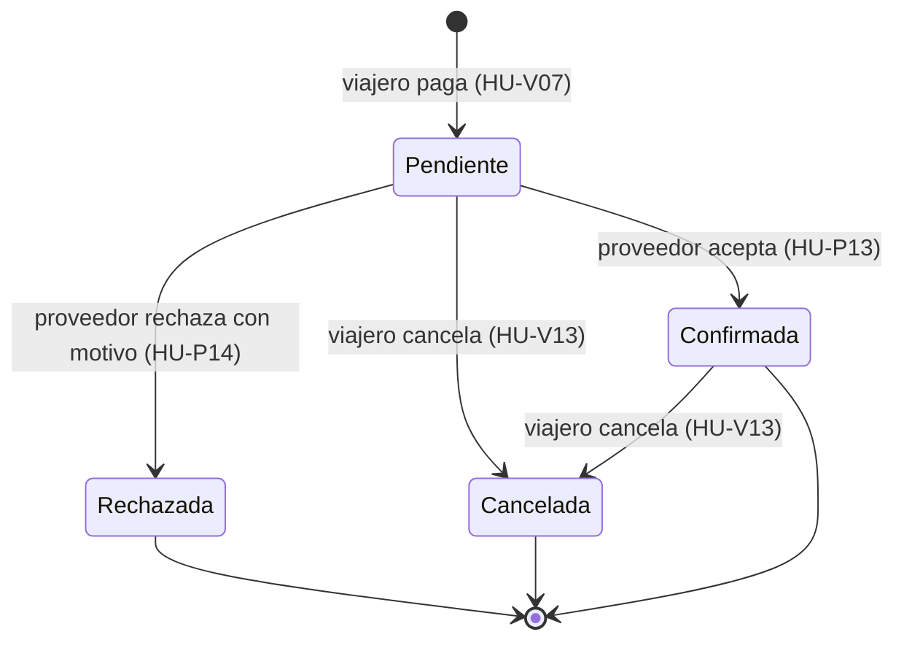

# Historias de usuario

[← Documentación](../README.md)

Trouvels360 tiene **30 historias de usuario: 15 del viajero y 15 del proveedor**, agrupadas en 8 épicas (4 por rol), con **130 criterios de aceptación** en formato Dado / Cuando / Entonces. Además hay **5 tareas técnicas de QA** (una por herramienta de la rúbrica y la trazabilidad), que no son historias porque no las pide un usuario.

| Documento | Contenido |
|---|---|
| [viajero.md](viajero.md) | HU-V01 a HU-V15 · 76 criterios · 59 pts |
| [proveedor.md](proveedor.md) | HU-P01 a HU-P15 · 54 criterios · 52 pts |
| [tareas-qa.md](tareas-qa.md) | QA-01 a QA-05: Karate, JMeter, Selenium, Appium y trazabilidad en Jira |
| [equivalencias.md](equivalencias.md) | Qué historia y criterio nuevo corresponde a cada identificador anterior (TRV-xxx, CA-TRV-xxx, HU-VIA/HU-PRO) |
| [Trouvels360_Historias_de_Usuario.docx](Trouvels360_Historias_de_Usuario.docx) | Las 30 historias y las tareas de QA en Word, para entregar o imprimir |

## Mapa de historias

Cada fila pone frente a frente lo que hace el viajero y lo que hace el proveedor en el mismo tema.

| Tema | Viajero | Proveedor |
|---|---|---|
| **Cuenta y acceso** | [HU-V01](viajero.md#hu-v01--crear-mi-cuenta-de-viajero) Crear mi cuenta de viajero [HU-V02](viajero.md#hu-v02--iniciar-sesión-y-volver-a-lo-que-estaba-haciendo) Iniciar sesión y volver a lo que estaba haciendo [HU-V03](viajero.md#hu-v03--actualizar-mis-datos-y-mi-contraseña) Actualizar mis datos y mi contraseña [HU-V04](viajero.md#hu-v04--eliminar-mi-cuenta) Eliminar mi cuenta | [HU-P01](proveedor.md#hu-p01--crear-mi-cuenta-de-proveedor) Crear mi cuenta de proveedor [HU-P02](proveedor.md#hu-p02--entrar-a-mi-panel-y-mantener-los-datos-de-mi-empresa) Entrar a mi panel y mantener los datos de mi empresa |
| **Panel e indicadores** | — | [HU-P03](proveedor.md#hu-p03--ver-mis-publicaciones) Ver mis publicaciones [HU-P04](proveedor.md#hu-p04--ver-los-indicadores-de-mi-negocio) Ver los indicadores de mi negocio |
| **Hoteles** | [HU-V05](viajero.md#hu-v05--buscar-hoteles-disponibles) Buscar hoteles disponibles [HU-V06](viajero.md#hu-v06--ver-un-hotel-y-cotizar-mi-estadía) Ver un hotel y cotizar mi estadía [HU-V07](viajero.md#hu-v07--reservar-un-hotel-con-pago-simulado) Reservar un hotel con pago simulado | [HU-P05](proveedor.md#hu-p05--publicar-un-hotel) Publicar un hotel [HU-P06](proveedor.md#hu-p06--editar-un-hotel) Editar un hotel [HU-P07](proveedor.md#hu-p07--gestionar-los-tipos-de-habitación) Gestionar los tipos de habitación |
| **Tours** | [HU-V08](viajero.md#hu-v08--buscar-tours) Buscar tours [HU-V09](viajero.md#hu-v09--ver-un-tour-y-cotizar) Ver un tour y cotizar [HU-V10](viajero.md#hu-v10--reservar-un-tour) Reservar un tour | [HU-P08](proveedor.md#hu-p08--publicar-un-tour) Publicar un tour [HU-P09](proveedor.md#hu-p09--editar-un-tour) Editar un tour [HU-P10](proveedor.md#hu-p10--armar-el-programa-de-actividades-del-tour) Armar el programa de actividades del tour [HU-P11](proveedor.md#hu-p11--programar-salidas-y-cupos) Programar salidas y cupos |
| **Reservas y aprobación** | [HU-V11](viajero.md#hu-v11--ver-mis-reservas) Ver mis reservas [HU-V12](viajero.md#hu-v12--saber-si-el-hotel-aceptó-o-rechazó-mi-solicitud) Saber si el hotel aceptó o rechazó mi solicitud [HU-V13](viajero.md#hu-v13--cancelar-una-reserva) Cancelar una reserva | [HU-P12](proveedor.md#hu-p12--ver-las-reservas-que-recibo) Ver las reservas que recibo [HU-P13](proveedor.md#hu-p13--aceptar-una-solicitud-de-hotel) Aceptar una solicitud de hotel [HU-P14](proveedor.md#hu-p14--rechazar-una-solicitud-de-hotel) Rechazar una solicitud de hotel |
| **Después del viaje y publicaciones** | [HU-V14](viajero.md#hu-v14--leer-y-escribir-reseñas) Leer y escribir reseñas [HU-V15](viajero.md#hu-v15--recibir-un-itinerario-sugerido) Recibir un itinerario sugerido | [HU-P15](proveedor.md#hu-p15--eliminar-una-publicación) Eliminar una publicación |

## El flujo principal en una línea

1. El proveedor publica un hotel (HU-P05) o un tour con salidas (HU-P08, HU-P11).
2. El viajero busca (HU-V05, HU-V08), cotiza con IGV (HU-V06, HU-V09) y paga con tarjeta de prueba (HU-V07, HU-V10).
3. **Hotel:** la solicitud queda PENDIENTE y aparta las habitaciones; el proveedor la ve (HU-P12) y la **acepta** (HU-P13) o la **rechaza** con motivo (HU-P14). El viajero ve el resultado (HU-V12).
4. **Tour:** se confirma al instante y descuenta cupos, sin aprobación (HU-V10).
5. El viajero puede cancelar (HU-V13), opinar tras su viaje (HU-V14) y pedir un itinerario sugerido (HU-V15).

_Estados de una reserva de hotel. Una reserva de tour nace Confirmada y solo puede pasar a Cancelada._

## Épicas

| Épica | Rol | Nombre | Historias | Puntos |
|---|---|---|---|---|
| EV1 | Viajero | Mi cuenta | HU-V01, HU-V02, HU-V03, HU-V04 | 13 |
| EV2 | Viajero | Hoteles | HU-V05, HU-V06, HU-V07 | 16 |
| EV3 | Viajero | Tours | HU-V08, HU-V09, HU-V10 | 11 |
| EV4 | Viajero | Mis reservas y mi viaje | HU-V11, HU-V12, HU-V13, HU-V14, HU-V15 | 19 |
| EP1 | Proveedor | Mi cuenta y mi panel | HU-P01, HU-P02, HU-P03, HU-P04 | 12 |
| EP2 | Proveedor | Mis hoteles | HU-P05, HU-P06, HU-P07 | 13 |
| EP3 | Proveedor | Mis tours | HU-P08, HU-P09, HU-P10, HU-P11 | 13 |
| EP4 | Proveedor | Reservas recibidas | HU-P12, HU-P13, HU-P14, HU-P15 | 14 |
| QA | — | Calidad y automatización | QA-01 a QA-05 (tareas técnicas) | 32 |

## Cómo leer una historia

Todas tienen la misma estructura, de lo más simple a lo más técnico:

| Parte | Para qué sirve |
|---|---|
| **Como / quiero / para** | Quién la pide, qué necesita y por qué. |
| **En pocas palabras** | La historia explicada sin términos técnicos. |
| **Ficha** | Épica, prioridad, story points, canales y el identificador anterior que reemplaza. |
| **Reglas de negocio** | Los límites exactos (formatos, rangos, estados). Son los que validan las pruebas. |
| **Criterios de aceptación** | Escenarios Dado / Cuando / Entonces con un id `CA-V05-02`; cada uno dice con qué casos se prueba. |
| **Cómo se prueba** | Los casos de prueba (Karate, Selenium, Appium, JMeter o manual) y su último resultado. |
| **API** | Los endpoints REST involucrados. |

## Convenciones

| Elemento | Formato | Ejemplo |
|---|---|---|
| Historia del viajero | `HU-Vnn` | HU-V07 Reservar un hotel con pago simulado |
| Historia del proveedor | `HU-Pnn` | HU-P13 Aceptar una solicitud de hotel |
| Criterio de aceptación | `CA-<historia>-nn` | CA-V07-05 Nunca se vende de más |
| Caso de prueba | `TC-API` Karate · `TC-WEB` Selenium · `TC-MOB` Appium · `TC-PERF` JMeter · `TC-MAN` manual | TC-API-029 |
| Tarea técnica de QA | `QA-nn` | QA-02 Plan de rendimiento con JMeter |

- **Prioridad:** Más alta, Alta, Media, Baja (MoSCoW adaptado a Jira).
- **Story points:** escala Fibonacci (1, 2, 3, 5, 8), según complejidad y riesgo, no horas.
- **Criterios:** cada historia tiene al menos un caso que pasa, uno que falla por validación y, cuando aplica, uno de seguridad (recurso ajeno o rol equivocado) y uno de concurrencia o idempotencia.
- Las historias cumplen **INVEST**: independientes (cada una se prueba con sus propios datos), negociables, valiosas para un rol concreto, estimables, pequeñas (2 a 8 puntos) y verificables (todos los criterios tienen un caso).

## Definition of Ready (para empezar una historia)

- [ ] Tiene como / quiero / para, reglas de negocio y criterios Dado / Cuando / Entonces.
- [ ] Los endpoints y los códigos HTTP esperados están definidos.
- [ ] Está estimada y priorizada, y sus datos de prueba se pueden crear por API.

## Definition of Done (para cerrar una historia)

- [ ] Todos los criterios funcionan en web y en móvil (cuando el canal aplica).
- [ ] Cada criterio tiene al menos un caso vinculado y el último resultado es «Pasó».
- [ ] El contrato de la API está cubierto por Karate (códigos, esquema y reglas).
- [ ] No hay defectos abiertos de severidad Alta o Crítica asociados.
- [ ] La evidencia (reporte HTML o capturas) está adjunta en Jira.
