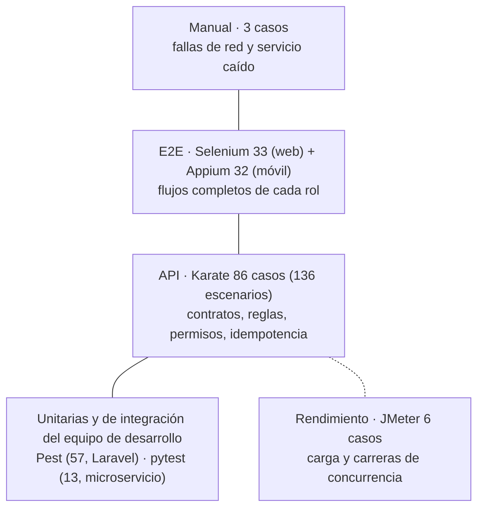

# Estrategia de pruebas

[← Documentación](../README.md) · [Catálogo de casos](casos-de-prueba.md) · [Matriz de trazabilidad](../3-trazabilidad/matriz-de-trazabilidad.md)

## 1. Objetivo

Demostrar que las 30 historias cumplen sus 130 criterios de aceptación en los tres canales (API, web y app Android) y que
las reglas críticas del negocio se mantienen bajo carga y concurrencia: **nunca se vende de más, nunca se cobra distinto
de lo cotizado y nadie accede a lo que no es suyo**.

## 2. Niveles y herramientas



| Nivel | Herramienta | Prefijo | Casos | Carpeta | Tarea |
|---|---|---|---|---|---|
| API (contrato y negocio) | Karate 1.4.1 | `TC-API` | 86 | `qa/karate` | QA-01 |
| Rendimiento y concurrencia | JMeter 5.6.3 | `TC-PERF` | 6 | `qa/jmeter` | QA-02 |
| Web de punta a punta | Selenium 4.25 + JUnit 5 | `TC-WEB` | 33 | `qa/selenium` | QA-03 |
| Móvil de punta a punta | Appium 2 (UiAutomator2) + JUnit 5 | `TC-MOB` | 32 | `qa/appium` | QA-04 |
| Exploratorio guiado | Manual | `TC-MAN` | 3 | [pasos](casos-de-prueba.md#pasos-de-los-casos-manuales) | — |
| Unitario / integración | Pest (Laravel), pytest (FastAPI) | — | 57 + 13 | `backend-laravel/tests`, `backend-itinerarios/tests` | — |

La colección de Postman en `qa/postman/` es de la versión base (20 historias) y se conserva como material complementario;
no forma parte de la trazabilidad.

### Qué se prueba en cada nivel

- **Karate:** todos los criterios que se pueden comprobar en la API: códigos HTTP, esquemas JSON (`schemas/*.json`),
  cálculos de IGV, estados de reserva, permisos por rol y por dueño, idempotencia y tiempos (`responseTime < 1000 ms`).
- **Selenium y Appium:** lo que solo se ve en la interfaz (mensajes, botones deshabilitados, diálogos de confirmación,
  volver a la pantalla anterior, estados vacío y error) y los flujos completos que cruzan roles (el proveedor acepta y el
  viajero ve CONFIRMADA).
- **JMeter:** el p95 del login, el catálogo de hoteles, la búsqueda de tours y el panel del proveedor, y las dos carreras:
  20 hilos por la última habitación (esperado 1 × 201 y 19 × 409) y 30 hilos sobre 10 cupos (esperado exactamente 10 cupos
  confirmados).
- **Manual:** tres situaciones difíciles de automatizar de forma estable (error del servidor al guardar, corte de red al
  cancelar y microservicio caído).

## 3. Técnicas de diseño de casos

| Técnica | Dónde se aplica | Ejemplo |
|---|---|---|
| Partición de equivalencia | Registro, búsqueda, pago | Correos válidos / inválidos / duplicados (TC-API-002, TC-API-003) |
| Valores límite | Cantidades, longitudes, cupos | 0 y 11 habitaciones (TC-API-021); comentario de 5 frente a 10 caracteres (TC-API-052); cupo total 5 con 6 reservados (TC-API-071) |
| Pruebas dirigidas por datos (CSV) | 8 archivos en Karate, 3 en JMeter | Tarjetas inválidas (Luhn, vencida, CVC) en `tarjetas-invalidas.csv` (TC-API-027) |
| Transición de estados | Reservas de hotel, salidas | Aceptar una reserva ya aceptada o cancelada → 409 (TC-API-033) |
| Tabla de decisión | Cancelación y reseñas | ¿Puede opinar? reserva confirmada × terminada × primera reseña (TC-API-051, TC-API-053) |
| Pruebas de seguridad | Todas las rutas privadas | Rol equivocado → 403 (TC-API-012), recurso ajeno → 403/404 (TC-API-034, TC-API-046), sin CSRF → 403 (TC-API-009) |
| Concurrencia e idempotencia | Reservas | Synchronizing Timer en JMeter (TC-PERF-003, 005); misma `Idempotency-Key` (TC-API-030, 043) |
| Consistencia entre canales | Mis reservas, salidas | Reservo en la web y la app muestra lo mismo (TC-MOB-020) |

## 4. Principios de automatización

- **Un caso, un identificador:** cada escenario o método lleva su `TC-xxx` en el nombre o la etiqueta. Ese id une la
  prueba con la historia en la matriz.
- **Pruebas independientes:** cada caso crea sus propios datos por API (hotel, tour, salida, usuario o reserva) en fechas
  lejanas y aleatorias, así se puede ejecutar en cualquier orden, en paralelo y sin limpiar la base.
- **Selectores estables:** `data-testid` en la web y `testTag` de Compose expuesto como resource-id en la app. Sin XPath
  absolutos.
- **Solo esperas explícitas:** `WebDriverWait` en Selenium y Appium; nunca `Thread.sleep`.
- **Evidencia automática:** captura de pantalla por caso (Selenium) o por paso (Appium) y reporte HTML en cada suite.
- **Configuración externa:** URLs, usuarios, capabilities y tamaños de carga se cambian por propiedades sin tocar el
  código (`karate-config.js`, `config.properties`, `user.properties`).

## 5. Entornos

| Entorno | API | Web | Uso |
|---|---|---|---|
| `local` | `http://localhost:8000/api` | `http://localhost:4200` | Desarrollo y corridas de las suites. Karate: `maxMs` = 1000. |
| `ci` | Variable `API_URL` (`-Dkarate.env=ci`) | Variable `BASE_URL` o `-Dbase.url=…` | Integración continua. Karate: `maxMs` = 2000; Selenium en modo headless (por defecto). |
| Emulador Android | `http://10.0.2.2:8000/api` | — | App en emulador API 26 o superior con Appium en `http://127.0.0.1:4723`. |

En el `.env` del backend **de pruebas** (no en producción) hay que subir los límites de uso, porque las suites crean
muchas cuentas e inicios de sesión:

```
LOGIN_RATE_LIMIT=1000
REGISTER_RATE_LIMIT=1000
CACHE_STORE=file
```

y luego ejecutar `php artisan config:clear`.

## 6. Datos de prueba

`php artisan migrate:fresh --seed` carga, además del catálogo de demostración, el **QaSeeder** (detalle en
[`backend-laravel/docs/DATOS_DE_PRUEBA.md`](../../backend-laravel/docs/DATOS_DE_PRUEBA.md)):

| Dato | Para qué |
|---|---|
| Viajero `edwinviajero@gmail.com` / `viajero` | Demostración: tiene reservas pasadas y 2 solicitudes pendientes |
| Proveedor `edwinproveedor@gmail.com` / `proveedor` | Dueño del catálogo y de los servicios QA |
| `qa.proveedor2@trouvels360.test` / `Proveedor123` | Segundo proveedor para las pruebas de recurso ajeno (403) |
| `qa.viajero1` a `qa.viajero30@trouvels360.test` / `Viajero123` | Usuarios de las suites y del CSV de JMeter |
| Hotel QA Concurrencia (Cusco) | Habitación Única de 1 unidad (carrera) y Doble a S/ 150 (cotización 600 + 108 = 708) |
| Tour QA Cupos (Cusco, Aventura, S/ 120) | Salida de 10 cupos (carrera), salida cerrada, salida pasada y cotización 360 + 64.80 = 424.80 |
| Tarjeta `4242 4242 4242 4242`, vencimiento futuro, CVC `123` | Pago simulado válido (`…4241` falla Luhn) |

## 7. Cómo ejecutar

1. Levantar el backend (`backend-laravel/levantar.bat`, recrea la base con los datos de prueba), el microservicio
   (`backend-itinerarios/levantar.bat`) y la web (`frontend-angular/iniciar-docker.bat`).
2. Comprobar: `http://localhost:8000/api/ping`, `http://localhost:8001/api/health` y `http://localhost:4200`.
3. Desde la raíz del repositorio:

```powershell
.\qa\ejecutar-todo.bat                 # Karate + Selenium + matriz de trazabilidad
.\qa\ejecutar-todo.bat jmeter appium   # además JMeter (requiere JMeter 5.6.3) y Appium (emulador + servidor Appium)
```

Cada suite también se ejecuta sola desde su carpeta con `ejecutar.bat` o `mvn test`. Por historia o caso:
`mvn test -Dkarate.options="--tags @TC-API-026"` en Karate y `mvn test -Dgroups=TC-WEB-011` en Selenium o Appium.

| Suite | Reporte |
|---|---|
| Karate | `qa/karate/target/karate-reports/karate-summary.html` |
| Selenium | `qa/selenium/target/reporte-selenium/index.html` (+ capturas, + Allure) |
| Appium | `qa/appium/target/reporte-appium/index.html` (captura por paso) |
| JMeter | `qa/jmeter/resultados/reporte-html/index.html` y `qa/jmeter/resultados/verificacion.txt` |
| Trazabilidad | `qa/trazabilidad/salida/matriz_trazabilidad.html` |

Los reportes de la última corrida entregada están en `qa/evidencias/etapa-5/`.

## 8. Criterios de entrada y de salida

**Para empezar a probar una versión**

- Backend, microservicio y web responden en sus URLs de salud.
- La base se recreó con `migrate:fresh --seed` y el `.env` de pruebas tiene los límites altos.
- La historia cumple la Definition of Ready (ver [historias](../1-historias-de-usuario/README.md#definition-of-ready-para-empezar-una-historia)).

**Para dar por aprobada una versión**

- 100 % de los criterios de aceptación con al menos un caso vinculado.
- 100 % de los casos de Karate y Selenium en «Pasó».
- Casos de Appium y JMeter ejecutados, con los p95 dentro de su objetivo y las carreras sin sobreventa.
- Ningún defecto abierto de severidad Alta o Crítica.

## 9. Gestión de defectos

Toda falla se registra como **Error** en Jira enlazado al caso y a la historia, con pasos, resultado esperado (el
criterio), resultado obtenido y evidencia. La plantilla y el flujo están en la
[guía de Jira](../4-jira/guia-de-importacion.md#5-registrar-un-defecto) y los defectos encontrados hasta ahora en
[defectos.md](../3-trazabilidad/defectos.md).

## 10. Estado actual

| Suite | Resultado de la última corrida |
|---|---|
| Karate | **136 / 136 escenarios OK** (86 casos), en paralelo con 5 hilos, ~19 s |
| Selenium | **33 / 33 OK** en Chromium headless |
| JMeter | Plan generado y validado; las carreras TC-PERF-003 y 005 se comprobaron con `concurrencia_smoke.py` (1 × 201 + 19 × 409; 10 cupos exactos de 30 intentos). **Falta la corrida con JMeter.** |
| Appium | Compila; los 184 resource-id que usa existen en la app. **Falta la corrida en un emulador.** |
| Manuales | **Por ejecutar** (pasos en el [catálogo](casos-de-prueba.md#pasos-de-los-casos-manuales)) |

## 11. Riesgos y cómo se mitigan

| Riesgo | Mitigación |
|---|---|
| Los límites de uso (429) cortan las suites | `.env` de pruebas con límites altos; sesiones compartidas en Karate con `callSingle` |
| Las pruebas chocan entre sí por usar las mismas fechas | Datos propios por caso en fechas lejanas y aleatorias |
| Pruebas inestables en la interfaz | Esperas explícitas, `data-testid` / resource-id y datos preparados por API |
| La app no alcanza la API en el emulador | URL `10.0.2.2:8000` en la app y en `config.properties` de Appium |
| El formato de fecha del emulador cambia el selector | `fecha.patron` configurable en `qa/appium/src/test/resources/config.properties` |
| El microservicio de itinerarios no está levantado | Solo afecta TC-API-054/055, TC-WEB-022 y TC-MOB-024; TC-MAN-003 prueba justamente ese caso |
